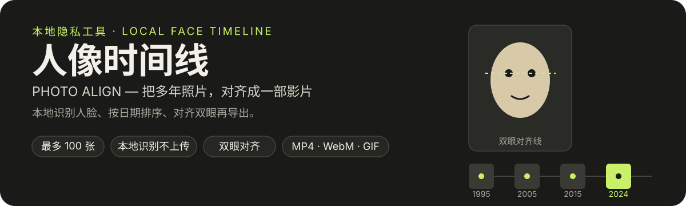
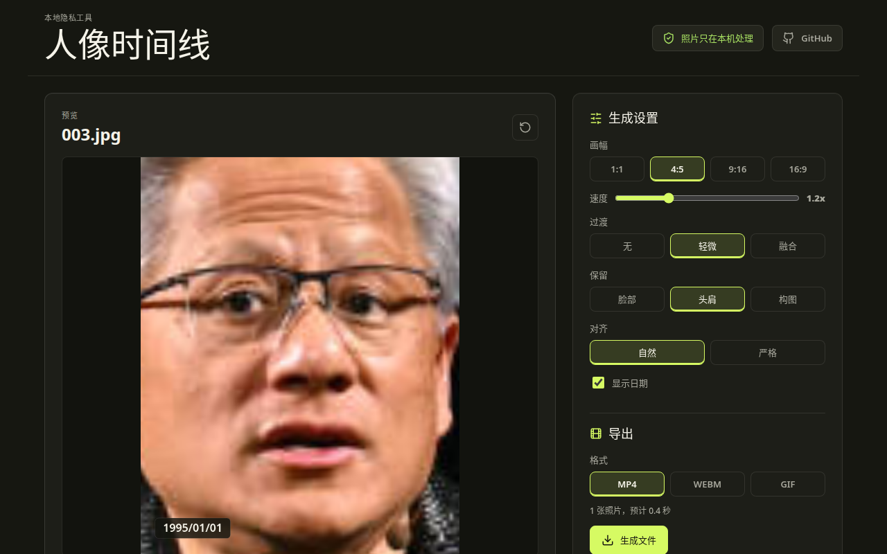

<p align="right"><a href="README.md">中文</a></p>

<p align="center">
  
</p>

<p align="center">
  <a href="https://holynova.github.io/photo_align/">▶ Live Demo</a>
  ·
  <a href="https://github.com/holynova/photo_align">GitHub Repository</a>
</p>

Photo Align is a browser-only face photo alignment tool: upload a set of portraits (up to 100), and it detects faces and eyes locally with MediaPipe, reads dates from EXIF or filenames, sorts by time, aligns the eyes, and exports an MP4 / WebM / GIF timelapse. Photos never leave your machine.

## Screenshots

<p align="center">
  
  
</p>

## Features

- **Local face detection**: MediaPipe Face Landmarker runs in the browser (model + WASM shipped in the repo), detecting faces and eye landmarks; in group shots you can pick the protagonist (up to 5 faces detected per photo).
- **Automatic dates**: EXIF shoot time first, filename parsing second; dates are editable, photos skippable.
- **Eye alignment**: all photos aligned on the eyes, with Natural / Strict modes; detection input capped at 1280 px on the long edge.
- **Settings**: aspect 1:1 / 4:5 / 9:16 / 16:9; speed 0.5×–3× (default 1.2×); transitions none / slight / blend; crop face / head-and-shoulders / original framing; optional date badge.
- **Export**: MP4 / WebM / GIF, with capability detection at startup (unsupported formats are disabled, never silently swapped); 24 FPS, 0.5 s base hold per photo; cancellable, retryable on failure.
- **Demo**: 30 built-in sample photos (labeled 1995–2024) — hit 「查看 Demo」 ("View Demo") to run the full detect-to-export flow without uploading anything.

## Run Locally

```bash
npm ci
npm run dev      # Vite dev server
npm test         # Vitest unit tests (date parsing, export frame plan)
npm run build    # tsc + Vite build
```

Publish to GitHub Pages: `npm run build:pages` (output to `docs/`, including demo photos and the local MediaPipe model).

## Tech

- React 19 + TypeScript + Vite; face detection uses @mediapipe/tasks-vision (Face Landmarker, local `.task` model + WASM); date reading uses exifr; GIF encoding uses gifenc.
- Export writes frame by frame (single reused canvas, GIF / MediaRecorder streaming encoding) without caching all full-resolution frames; the decode cache decodes each photo once and releases it after export.

```
src/App.tsx               Main UI and the whole flow: upload, detect, sort, align, export
src/lib/photo-date.ts     EXIF / filename date parsing
src/lib/export-plan.ts    Export frame plan: 24 FPS, hold duration, transition frames
public/mediapipe/         Face Landmarker model + WASM (runs locally, no CDN)
demo/                     30 sample photos + manifest.json
```
