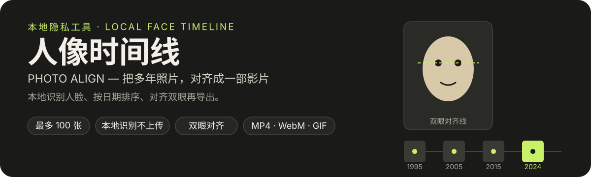
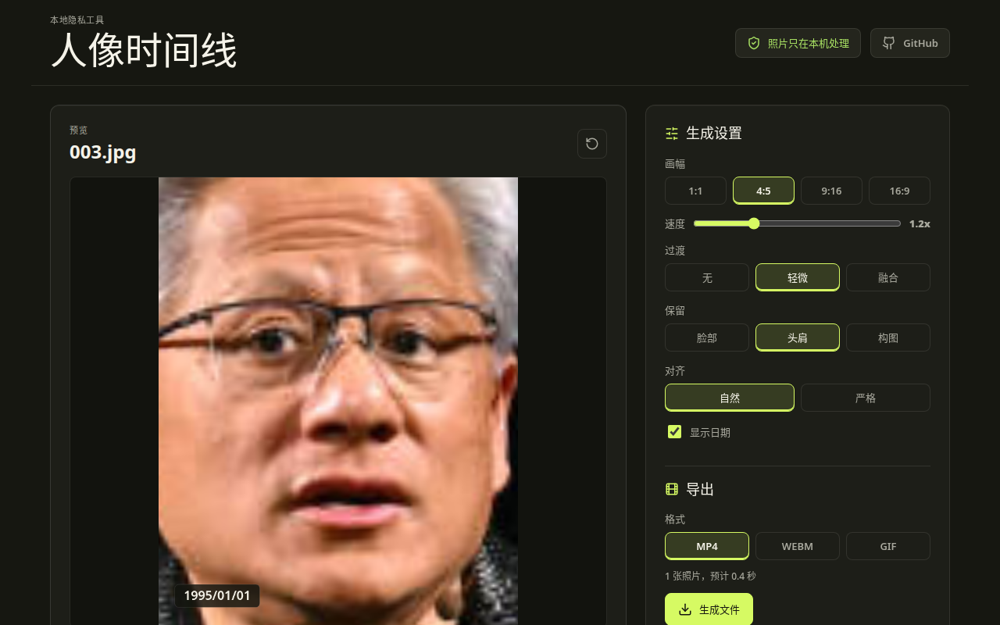

<p align="right"><a href="README.en.md">English</a></p>

<p align="center">
  
</p>

<p align="center">
  <a href="https://holynova.github.io/photo_align/">▶ 在线体验</a>
  ·
  <a href="https://github.com/holynova/photo_align">GitHub 仓库</a>
</p>

人像时间线是纯前端的人脸照片对齐工具：上传一组人物照片（最多 100 张），浏览器本地用 MediaPipe 识别人脸与双眼，从 EXIF 或文件名读取拍摄日期，按时间排序、对齐双眼，导出 MP4 / WebM / GIF 渐变时间线。照片只在本机处理，不上传服务器。

## 截图

<p align="center">
  
  
</p>

## 功能

- **本地人脸识别**：MediaPipe Face Landmarker 在浏览器本地运行（模型与 WASM 随仓库提供），识别人脸与双眼关键点；多人照片可选择主角（最多识别 5 张脸）。
- **日期自动读取**：优先 EXIF 拍摄时间，其次从文件名解析；日期可手动编辑，照片可跳过。
- **双眼对齐**：按双眼位置对齐全部照片，两种对齐模式（自然 / 严格）；识别框最大边 1280 px。
- **生成设置**：画幅 1:1 / 4:5 / 9:16 / 16:9；速度 0.5x–3x（默认 1.2x）；过渡无 / 轻微 / 融合；保留范围脸部 / 头肩 / 构图；可显示日期角标。
- **导出**：MP4 / WebM / GIF 三种格式，启动时检测浏览器支持能力，不支持的格式自动禁用、不会静默改格式；24 FPS，每张照片基准停留 0.5 秒；导出可取消、失败可直接重试。
- **Demo**：内置 30 张示例照片（1995–2024 年标签），点「查看 Demo」不用上传就能走完识别到导出的完整流程。

## 本地运行

```bash
npm ci
npm run dev      # Vite 开发服务器
npm test         # Vitest 单元测试（日期解析、导出帧计划）
npm run build    # tsc + Vite 构建
```

发布到 GitHub Pages：`npm run build:pages`（输出到 `docs/`，含 Demo 照片与 MediaPipe 本地模型）。

## 技术

- React 19 + TypeScript + Vite；人脸识别用 @mediapipe/tasks-vision（Face Landmarker，本地 `.task` 模型 + WASM）；日期读取用 exifr；GIF 编码用 gifenc。
- 导出逐帧写入（复用单一画布，GIF / MediaRecorder 流式编码），不缓存全部高清帧；解码缓存每张照片只解码一次，导出后主动释放。

```
src/App.tsx               主界面与全部流程：上传、识别、排序、对齐、导出
src/lib/photo-date.ts     EXIF / 文件名日期解析
src/lib/export-plan.ts    导出帧计划：24 FPS、停留时长、过渡帧数
public/mediapipe/         Face Landmarker 模型与 WASM（本地运行，无需 CDN）
demo/                     30 张示例照片 + manifest.json
```
